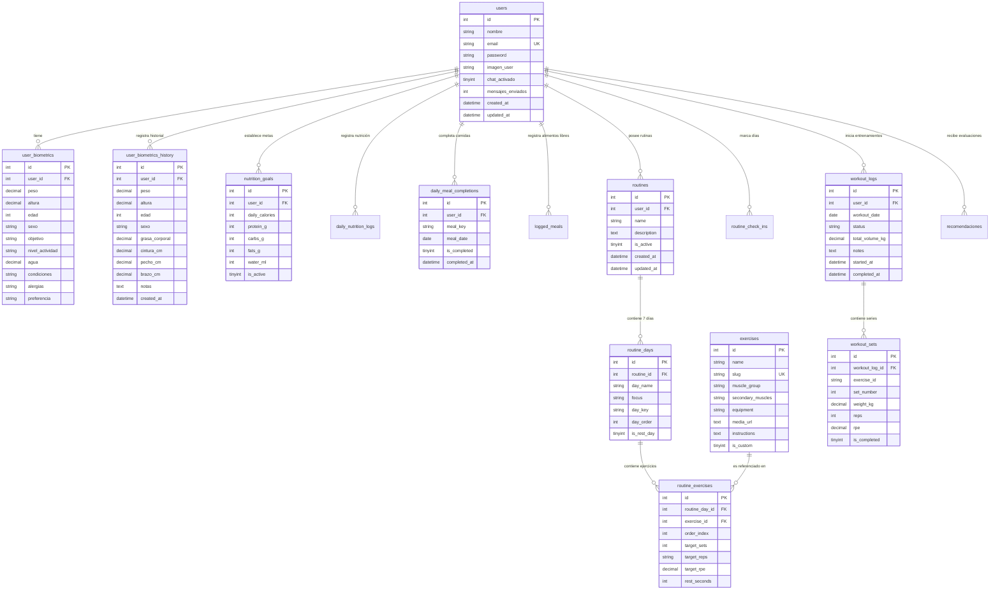

# Diccionario de Datos y Modelo Relacional - Kynap Database

## 1. Esquema de Base de Datos
- **Motor**: MySQL 8.0+ / MariaDB 10.4+ (InnoDB)
- **Codificación**: `utf8mb4_unicode_ci`
- **Total de Tablas**: 18 tablas

---

## 2. Diagrama Entidad-Relación (Mermaid ER)

---

## 3. Diccionario Detallado de Tablas

### 3.1 `users`
Almacena las credenciales principales y preferencias de sesión de los atletas.
| Campo | Tipo | Nulo | Descripción |
|---|---|---|---|
| `id` | INT AUTO_INCREMENT | NO | Identificador único del usuario (Clave Primaria). |
| `nombre` | VARCHAR(100) | NO | Nombre completo sanitizado del atleta. |
| `email` | VARCHAR(120) | NO | Correo electrónico único de acceso (Índice Único). |
| `password` | VARCHAR(255) | NO | Contraseña con hash criptográfico BCRYPT (cost 12). |
| `imagen_user` | VARCHAR(255) | SÍ | Ruta al avatar de perfil (ej. `icon_users/Boy.jpg`). |
| `chat_activado` | TINYINT(1) | SÍ | Flag de activación del asistente virtual (1 = Activo). |
| `mensajes_enviados` | INT | SÍ | Contador de mensajes procesados con el asistente. |
| `created_at` | DATETIME | NO | Marca de tiempo de registro. |
| `updated_at` | DATETIME | NO | Marca de tiempo de última actualización. |

### 3.2 `user_biometrics`
Almacena el perfil fisiológico y preferencias deportivas actuales del atleta.
| Campo | Tipo | Nulo | Descripción |
|---|---|---|---|
| `id` | INT AUTO_INCREMENT | NO | Identificador único de registro. |
| `user_id` | INT | NO | Clave foránea referenciando a `users(id)`. |
| `peso` | DECIMAL(5,2) | NO | Peso corporal en kilogramos. |
| `altura` | DECIMAL(5,2) | NO | Estatura en centímetros. |
| `edad` | INT | NO | Edad cronológica en años. |
| `sexo` | VARCHAR(20) | SÍ | Género fisiológico (`masculino`, `femenino`). |
| `objetivo` | VARCHAR(50) | SÍ | Meta principal (`ganar_musculo`, `bajar_peso`, `mantener`). |
| `nivel_actividad`| VARCHAR(50) | SÍ | Factor de actividad (`sedentario`, `moderado`, `activo`, `intenso`). |
| `agua` | DECIMAL(4,2) | SÍ | Consumo objetivo de agua en litros por día. |
| `condiciones` | VARCHAR(255) | SÍ | Condiciones osteomusculares o médicas. |
| `alergias` | VARCHAR(255) | SÍ | Alergias o intolerancias alimentarias. |
| `preferencia` | VARCHAR(100) | SÍ | Preferencia dietética o equipamiento disponible. |

### 3.3 `user_biometrics_history`
Historial de evolución física y composición corporal en cada ciclo de rutina completado o ventana de corrección.
| Campo | Tipo | Nulo | Descripción |
|---|---|---|---|
| `id` | INT AUTO_INCREMENT | NO | Identificador único de la toma de medidas. |
| `user_id` | INT | NO | Clave foránea a `users(id)`. |
| `peso` | DECIMAL(5,2) | NO | Peso corporal registrado. |
| `altura` | DECIMAL(5,2) | NO | Altura registrada. |
| `edad` | INT | NO | Edad al momento del registro. |
| `sexo` | VARCHAR(20) | SÍ | Género. |
| `grasa_corporal` | DECIMAL(4,1) | SÍ | Porcentaje de grasa corporal estimado. |
| `cintura_cm` | DECIMAL(5,1) | SÍ | Circunferencia de cintura en cm. |
| `pecho_cm` | DECIMAL(5,1) | SÍ | Circunferencia de tórax en cm. |
| `brazo_cm` | DECIMAL(4,1) | SÍ | Circunferencia braquial en cm. |
| `notas` | TEXT | SÍ | Observaciones cualitativas del atleta. |
| `created_at` | DATETIME | NO | Momento exacto de toma de la medición. |

### 3.4 `routines`, `routine_days` y `routine_exercises`
Jerarquía completa de planificación de entrenamientos:
- **`routines`**: Cabecera del plan (nombre, descripción, flag `is_active`).
- **`routine_days`**: 7 registros por rutina (`day_key`: `lunes` .. `domingo`, `focus`, `is_rest_day`, `day_order`).
- **`routine_exercises`**: Ejercicios estructurados dentro de cada día (`target_sets`, `target_reps`, `target_rpe`, `rest_seconds`, `order_index`).

### 3.5 `exercises`
Catálogo maestro de ejercicios con mapeo muscular, requerimiento de equipo e instrucciones técnicas y enlaces a recursos multimedia (`.gif` / `.jpg`).

### 3.6 `nutrition_goals`, `daily_meal_completions` y `daily_nutrition_logs`
- **`nutrition_goals`**: Metas calóricas diarias y división de macronutrientes (`daily_calories`, `protein_g`, `carbs_g`, `fats_g`, `water_ml`).
- **`daily_meal_completions`**: Registro de check-in diario para cada uno de los 5 bloques alimenticios (`desayuno`, `media_manana`, `almuerzo`, `merienda`, `cena`) con reinicio a medianoche.
- **`daily_nutrition_logs`**: Resumen acumulativo por fecha (`water_ml`, `calories_target`, `water_target_ml`).

### 3.7 `workout_logs` y `workout_sets`
- **`workout_logs`**: Sesiones de entrenamiento iniciadas (`status: in_progress / completed`, `total_volume_kg`, marcas de tiempo).
- **`workout_sets`**: Series ejecutadas en tiempo real (`set_number`, `weight_kg`, `reps`, `rpe`, `is_completed`).

### 3.8 `routine_check_ins`
Registro de asistencia y cumplimiento de rutina por semana y año (`week_number`, `year`, `day_id`, `check_in_date`, `is_completed`).

### 3.9 `recomendaciones`
Evaluaciones de progreso generadas por la IA deportiva al completar cada rutina semanal con métricas y directrices de sobrecarga progresiva.

